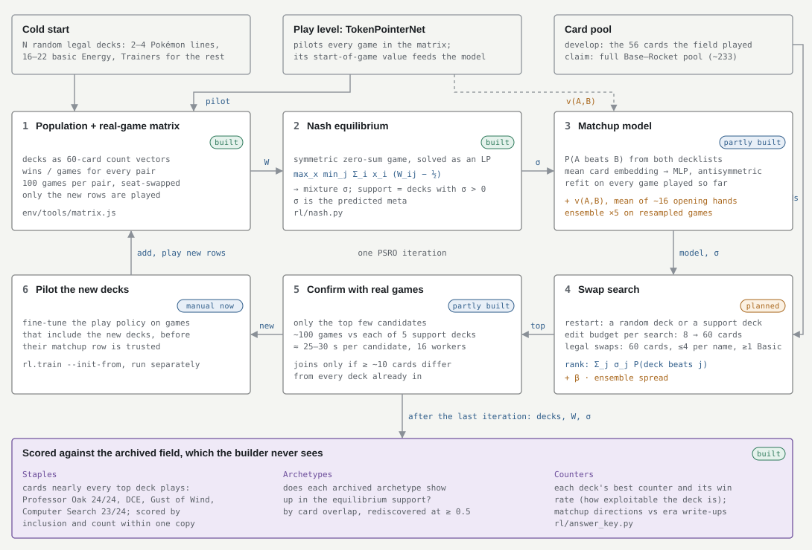

# Metagame RL

A reinforcement-learning project on trading-card-game metagames. The first and main focus is the Pokémon
Trading Card Game (PTCG); other TCGs come later. The roadmap:

1. **July 2000 Super Trainer Showdown** (Pokémon, Base–Rocket): the proving ground (Phase A, now)
2. **Worlds 2005, San Diego** (Pokémon, EX era): a full World Championships metagame (Phase B)
3. **Magic: The Gathering**: a second game, once the approach holds on Pokémon (not started)

The Pokémon environment is
[evcoats/ryuu-play](https://github.com/evcoats/ryuu-play) (branch `sts-2000-pool`), a fork of
[keeshii/ryuu-play](https://github.com/keeshii/ryuu-play), the open-source Pokémon TCG simulator
in TypeScript. The fork is included here as the `ryuu-play/` submodule.

**The goal:** give an agent only a card pool and the rules. It learns to play any deck, learns
to build the decks worth playing, and then is checked against a real historical tournament
metagame that it never saw.

For Pokémon, the end target is a full **World Championships metagame**. The first target is
deliberately much smaller: the **July 2000 Super Trainer Showdown (California)**. It has a 56-card field
that is now fully implemented in the engine and verified. Every part of the system gets built
and proven there first.

## In short

**The approach, in three parts:**

1. **A pilot** (one transformer policy) learns by self-play to play any deck.
2. **A builder** edits decks, judging each one through the pilot's own value and representations.
3. **PSRO** keeps the decks worth playing as an equilibrium mixture, since card metagames are
   rock–paper–scissors rather than one best deck.

The input is only the rules and the card pool: no human decklists, card-specific rules or fitted
priors. The test is whether the result matches a real tournament field it never saw. (Phase A
still has two priors to remove: the builder uses only the 56 cards the field played, and random
starting decks are shaped like human decks, with 16–22 Energy.)

**What is new:**

- **The test is self-discovery.** Does an agent that starts from random decks rediscover what humans
  actually played? Archived lists are used only as the answer key (staples, archetypes, counters),
  never as input.
- **Play and deck building are learned together, by one model.** The builder sees decks the way
  the pilot plays them, so deck quality is defined by play.
- **No prior work combines these for the Pokémon TCG.** We found no published RL work on its deck
  building and play. The closest are surrogate-assisted deck search in Hearthstone and a single
  draft-and-battle policy in Legends of Code and Magic (see the
  [2026-10-06 analysis](notes/analysis-2026-10-06.md)).

**The main lesson so far:** every deck judgment passes through the pilot. A biased or weak pilot
gives a biased or blind builder, so pilot strength is the bottleneck.

## Status

<!-- status:start -->
*Updated 2026-10-29.*

**Where things stand.** A0, A1 and A3 are done, A2 has its ladder and the SimpleBot matchup matrix, and Phase B's engine plays two 2005 lists and passes a fuzz over 340 cards. Every learned drafting loop ended with more Energy and fewer Trainers than the human lists, and the best recipe (round479 with the restored gate, C91) has near-list decks that beat the lists, but that shape lives in the 479 population rather than its pilot. On a quarantined bench of four human lists, the pilot's sub-Energy Trainers are now traced card by card: Computer Search is capped by what it fetches, and PlusPower, the drafts' largest deficit, is a timing failure the pilot can see but does not act on, worth about an Energy when timed right at any pilot strength. An engine audit against outside card texts and the 2000 rules found the engine faithful apart from minor faults off the bench; what differs from real play is pace, as these pilots take about 50 turns to finish a game, so long games end by deck-out, which punishes the human lists' draw Trainers (they lose 60-40 to their Energy copies untimed) and makes the drafts' Energy lean rational. Pace tests then showed the slow games are the pilots' play: a scripted line wins in about 9 own turns where every pilot needs 19-32, because the pilots under-play the speed Trainers (PlusPower, Bill, Professor Oak) and the full Bench, yet in games this long holding Oak is the right answer, and neither a per-turn discount that makes faster wins worth more (BENCH-P9) nor forced Trainer-play exploration (BENCH-P10) moved the speed Trainers' play or the lists' value under the real round clock: exploration taught the value that playing Oak loses in these games, so the pilot held it more. Drafting has resumed from the gated base, which today's code reproduces, with the drafted decks still carrying under a fifth of the lists' tempo Trainers.

- **Log #1–56 (A0–A5, B1–B2; rolled up from eight block summaries).** The engine and environment cover
  the 2000 field and were verified against an oracle (0 mismatches over 1.65M checked decisions), with
  engine faults and free action cycles fixed on the way, and Phase B moved to Worlds 2005, whose engine
  branch plays Birds and ZapTurnDos and passes a 1,500-game fuzz over 340 cards. Trained pilots beat
  SimpleBot (the token model 93% when trained on the archived decks, human-free pilot-v2 near 83%), but
  deck search driven by the pilot's value keeps flooding decks with Energy and no change to the search
  fixed it, neither extra attention nor play-time search transferred to an outside opponent, and the
  first built metagame to beat the archived field (60.7%, [2000s result #1](results/2000s-result-1/)
  and log #40) came from piloting every PSRO iteration. Under the general self-discovery scope set at
  #51, co-evolving the decks and one pilot over the full pool rediscovered Computer Search, Scyther,
  Oak, Energy Removal and Double Colorless Energy but collapsed to one deck type, so the metagame moved
  to a league of deck-owning agents with separate networks and a two-stage real-game adoption check.
- **Log #57–120 (A4, A5, plan; rolled up from eight block summaries).** Tournaments of deck-owning agents
  ([2000s result #2](results/2000s-result-2/)) kept their deck types distinct but drifted into Pokémon piles (0/8
  archetypes), so the meta level became one learned loop, `rl/metagame.py` (99 decks sharing one pilot and one draft head
  trained on game results, with turnover; the older code at the `pre-simplify` tag), whose first best decks broke even
  with the human lists under pilot-v2. Pilot architecture screens stayed within their noise, and taking the human lists as
  ground truth (Evan) traced the decks' distance from them to the pilot, which does not set up before attacking and so
  values every Trainer but Oak and Bill below an Energy; the lab (`rl/lab.py`) then trained the loop as a main line whose
  forks are decided against it on bars set by A/A cards, Evan's ideas first and then the approved three-stage plan. It
  adopted 2 PPO epochs, 6 swaps a draw, the result-only draft reward, Evan's deck-free board encoder, learning rate 2e-4
  and a slower draft head, but no pilot change (memory in three forms, expert iteration toward a turn search, in-turn
  credit, entropy, depth, slot binding) moved Trainer competence from 0.43–0.48, practice before a draw counts failed on
  deck shape, and the population held one deck type from 160 on while its shape swung (closest to the human lists at 360,
  10.5 Energy above them at 400 in a deck-out meta), so when the plan's stall rule fired Evan chose a league of three
  draft heads sharing one pilot; lab bookkeeping faults that silently changed or risked decisions recurred throughout and
  were each fixed as found.
- **Log #121–184 (A5; rolled up from eight block summaries).** The one wall type was traced from a drafting ratchet and
  a specialised shared pilot (answered with selection on real results, group changes, practice games and wide turnover)
  to the judge: every pilot grown with the walls rates them 0.68-0.75 against the human lists, no drafting, selection,
  diversity or pilot-training change (type caps, KL anchors, challengers, exploiters, value targets, a significance gate)
  unseated them, and they fall under half the points only when both seats search and the round is cut early. With the
  2000 round rule in the game (Evan's decision) the loop came closest to the human shape of any run (6.3-6.8 cards off
  against 9.6-11.7) while walls still held 44-69 of 99 decks, and human-free pilots paid the round's points or given
  soft search targets gained 54-57 Elo on the human lists yet rated the walls as high or higher (0.504-0.641 of the
  event points), so stronger tactical play did not unseat them; the research loop's own collapse onto two wall states
  became a written method with rivals, pre-written bands and an exploration floor, which now runs unattended as code.
  Its first prevention start, fresh wide decks with the warm pilot under the rule, moved its population median from
  10 / 27 / 24 to 14 / 27 / 19 in 14 iterations without the slide into Pokémon piles of every earlier from-scratch run,
  though the decks it rates best still carried about 6 too few Trainers and 6 too much Energy.
- **Log #185–248 (A5; rolled up from eight block summaries).** Fresh wide decks slid into Pokémon piles from the draft head's near-uniform proposals (C51), and drawing proposals from the pilot's own card similarity (Nf, C52; provisional R1, graded B by #231's audit) cut the slide to about a third and brought the population median to the lists' 14 / 28 / 18 around iterations 9-14 at two seeds, but every run then traded 3-5 Trainers for Energy as selection paid Energy in every window, and a frozen, stronger judge leaned the same (C53). That lean traced upstream of selection to the pilots: both human-free pilots, greedy or searching, price the human lists' search, disrupt and tempo Trainers below a basic Energy (C59), an audit of all 42 Trainers fixed the engine's faults without changing that price, and fast probes located it in the pilot's answers inside its own Trainer prompts, no better than random (C68 X1) although lookahead answers there are worth +0.044 (C73, one seed), while no input named the card that opened a prompt and the search targets scored Trainer plays with those same answers. A Karpathy-style 5-minute loop (`ar/`) built to raise the lists' Trainer share M ran 21 changes with no effect beyond noise, its keep bar of 0.01 having come from a 3-seed A/A that understated the run-to-run sd (about 0.0115) six times, and literature searches for Evan's rows 64-66 queued move-level training signals and designed opt-in keys under which options and the state refer to each card through its one encoded token, built as staged patches that are bit-identical when off.
- **Log #249–312 (A5; rolled up from eight block summaries).** On build K (a bug batch, a 1,600-line cleanup, and an opt-in chain head and card-token keys, all bit-identical when off), the fast `ar/` loop and 110-iteration arms tested Evan's ideas and the pilot's Trainer-prompt answers: the keys and the chain head were null, a target-signal probe found a better answer inside a Trainer worth only +0.018 of a game a prompt with a single PPO visit far too noisy to learn it, and a Q over a prompt's answers under three targets (one return, the next-turn value, the pilot's own branched returns) gave no answer gain, so the prompt-answer line closed. The ground truth then moved through the draft's selection: the `--select-z` gate the 10-24 cleanup had removed by mistake was restored, round479 with it (C91) reproduced C47's best shape at two seeds (distance 6.43 against 5.33), and its best decks win 0.44-0.45 of decisive games against the lists under a frozen pilot against 0.11-0.22 for every fresh-deck screen, while putting the 479 lineage's pilot on fresh decks (C92) changed nothing, so that shape is carried by the 479 population and draft head rather than its pilot. From fresh decks, paired selection (C90) doubled G3 at one seed but not at the second, though it kept the drafted shape closer to the lists; along the way runs became pausable for Evan's games, which had stopped runs three times in two days, the three agents gained a one-step launcher, and the overnight queues learned to launch each screen in its own thread.
- **Log #313–376 (A5, the bench; rolled up from eight block summaries).** On the fixed engine the restored selection gate kept fresh-deck drafting closer to the lists' shape over four seeds without making its decks stronger, C91's near-list decks (0.57 of decisive games against the lists once an ultrareview fixed G3's deck order) proved carried by the 479 population rather than its pilot, and value heads tested against branched oracle values (C94-C96) met no band, ridge heads on the pilot's option vectors holding only part of the signal. Priced alone, Computer Search was the one Trainer clearly under an Energy, oracle answers lifted it only +0.05 and the clock not at all, and card ids proved global with content embeddings already in place, so Evan moved pilot design onto a quarantined bench of four human lists, where 30 minutes of the plain recipe made the pilot clearly stronger (0.615 of the mirrors) but left Computer Search and Item Finder under an Energy, oracle choices plus timing put Computer Search only at 0.50-0.54, P2 came out level with arm 0 (R-dead by the letter), and P1 missed its report gate because Computer Search's and Item Finder's content rows are near-identical (cosine 0.98 under every centring). With the goal now per card and per list, and an audit estimating that a 30-minute arm sees 20-40x too few Computer Search fetches for PPO to learn a per-pick signal (so architecture arms read mechanism, not outcome), the bench oracle came in far more reliable than C94 (split-half R 0.775 against 0.503), a per-Trainer pick counter was built, P4 was recorded to run chained segments if its mechanism passes, and Evan's 14:03 go keeps the program running without waiting on approval; one recurring cost is GPU contention, which killed P2's second seed once and now holds every test off a wall-clock arm.

- **Log #377–440 (A5, the bench; rolled up from eight block summaries).** On the bench, plain PPO learns Computer Search's answers and the card stays under an Energy because an extra copy of what it fetches is worth no more than an Energy, while better discards, timing and the pilot's Energy count explained none of it; the card-identity arms (P2, P1b, P1c) showed live binding mechanisms but no outcome, P1c's seeds being stopped by the KL rule in a pattern later traced to cold optimizer starts. With the focus moved to the drafts' actual deficits (PlusPower, Gust, Item Finder and Scoop Up, all under an Energy at 256 games), PlusPower proved a timing failure: the pilot plays it 4-6 times more often when it cannot attack although its state separates the cases, and an oracle timing it lifts it to about an Energy at every matched pilot strength (C111), so pilot strength is not the lever, while oracle Gust targets added little. Training-time branching at PlusPower decisions (P5) moved the policy most of the way without flipping its inverse pattern or the price, and probes then found the knockout margin carried to the decision point.

- **Log #441–504 (A5, the bench and the engine audit; rolled up from eight block summaries).** Training-time branching at PlusPower decisions (P5 through P5d, and Trainer-wide in P8) raised the pilot's knockout catches toward the oracle's and PlusPower's price by about +0.02-0.04 but never taught it the right turns, and spread over every Trainer it made the pilot weaker, which ended that line by its rules. Evan then asked why the engine would reward anything but the real game, and an audit against outside card texts and the 2000 rules found it faithful (its suites, 32 scripted rule cases, the card data for every pool Pokémon and the effects of the 70 most-played Pokémon) apart from minor faults off the bench, with fixes proposed for review. What differs is the games' length: 81-85% of bench games end on the turn cap with the Prize lead deciding them, and played longer the human lists lose to their Energy-heavy copies (about 0.38-0.40) because the Trainer-rich list decks out first, so the drafts' Energy lean answers the game these pilots play.

- **Log #505–512 (A5, pace).** Against a passive opponent every pilot still needs 19-32 own turns to take six Prizes, yet the engine's flow checks out (opening hands and mulligans at the hypergeometric expectation, damage and Do the Wave as printed), and the pilots skip the speed line: PlusPower on almost none of Wigglytuff's attacks, Professor Oak or Bill held on most turns, the Bench full on a quarter to two fifths of attacks. The cited real-play pace (six knockouts in seven turns) turned out to be a deck builder's best case for Wigglytuff with a full Bench and PlusPower, not a measured game.

- **Log #513–520 (A5, pace and P9).** A scripted Wigglytuff line with a full Bench and PlusPower wins in a median 9 own turns whenever its pieces arrive by turn 4, so the engine can deliver human pace, but branched play-to-game-end checks show the pilots are right to hold Professor Oak (playing it costs about 0.05 of the reward, more as the deck thins) and that Bill is neutral, because in games this long extra draw burns the deck. The under-played draw Trainers are thus the right answer to these long games rather than a learning failure, and nothing in the training objective rewards a faster win. BENCH-P9 therefore adds a discount per game turn (0.98) to arm 0's recipe, and it launched at two seeds after its γ = 1 identity check reproduced arm 0's advantages bit for bit on a real training batch.

- **Log #521–528 (A5, P9 and P10).** A discount of 0.98 a game turn (BENCH-P9) read between by its bands at both seeds: it raised knockouts per own turn in the mirrors 1.13× and cut deck-outs and retreats, but games ran as long, the passive-opponent pace and the speed Trainers' play did not change, the human lists' value under the real-STS clock stayed at arm 0's (+0.000 / +0.007), and the pilot came out slightly weaker. Since a pilot that rarely plays its Trainers never sees what follows a played one, BENCH-P10 then forced a uniform legal Trainer play at a tenth of the decisions where one is legal, kept those rows out of the policy loss and let the value learn from what followed, after reproducing arm 0's batch and update exactly at ε 0; its first seed was stopped by the KL rule. Arm 0's own two seeds differ by 0.03 on the human lists' value, about the size of the bands' threshold, so every arm needs both seeds to read.

- **Log #529–536 (A5, the bench's close and the return to drafting).** P10's forced Trainer plays taught the value what follows a played Professor Oak, and since that is a loss in these games the pilot held Oak and Bill twice as often and got weaker, so P10 closed with no effect claimed; a test against a scripted fast opponent (C117) was invalid because the script is fast only against a passive opponent, and a search-continuation test of whether the pilot can use what it draws (C118) was written and held for usage. With every bench lever leaving the speed Trainers unplayed, Evan chose to resume drafting from the gated base (row 103), first re-measuring C90's paired-gate recipe at two new seeds on today's code (C119), read on deck shape (G1) and the tempo-card counts.

- **Log #537–544 (A5, drafting resumes; the engine fix).** C119 reproduced the gated drafting base on today's code at two new seeds (R-repro): the best decks sit 13.0 and 13.8 from the lists' shape and carry 1.8 and 1.6 copies a deck of PlusPower, Gust, Item Finder and Scoop Up against the lists' 9.2, inside bands that, once each seed's own sampling error was added before the readout, are honest about a 12-deck mean's noise. The audit's two card faults were then fixed in ryuu-play with specs that fail on the old code (Blastoise's Rain Dance now attaches only to Water Pokémon; Gastly's Energy Conversion always does its self-damage), every suite passing and the edits left uncommitted for Evan, so every job now plays the fixed build. Running two drafting screens side by side left too little RAM, so they run one seed at a time, and a detached stage sequencer lost 8 minutes to a missing PATH before its fix.

- **Log #545–552 (A5, the fixed base and the first levers).** On the fixed engine the gated base read between until a third seed came in closer to the lists' shape than any before (distance 7.4), so the fixed build became the drafting base, with nine gated seeds averaging 11.9 ± 4.2 on shape and 2.1 ± 0.4 tempo-card copies a deck against the lists' 9.2, and research added a stop rule for screens whose decks drift toward Pokémon. Evan then asked the agents to stop waiting for approval and to run experiments in parallel, so the first levers were built and launched back to back: a per-turn discount for the drafting loop (C121) and a search-priced pricing test (C122), while a two-turn search continuation for Oak (C118) halved Oak's cost without making it pay (R-not-conversion), so a pilot that can't use its draws isn't the whole reason it holds Oak. A live screen measured 4.3-5.0 GB of RAM, matching the launcher's 5 GB allowance, so RAM fits two screens at a time.

**Recent (log #553–557).** Pricing Trainers with the pilot's own search at Trainer-playable decisions (C122) read between: it played PlusPower about seven times as often at both eval seeds but lifted the lists' value at only one (−0.01 and +0.06), so that line stopped. The per-turn discount in the drafting loop (C121) met its tempo-card band at two seeds (2.7 and 2.9 copies a deck against the base's 2.1, still far below the lists' 9.2) without moving deck shape or the loop's deck-out rate, so seeds 10 and 11 replicate before any claim, and a longer run of the gated base from iteration 29 to 59 (C123) tests whether drafting time alone brings the decks closer to the lists.

The full record is in [`notes/progress-log.md`](notes/progress-log.md).

**Next:**

1. C121's replication (seeds 10 and 11) of the per-turn discount's tempo-card lift, and C123 (the gated base continued to
   iteration 59), both running or queued; research's next levers into the free GPU slots. The ryuu-play fix waits for
   Evan's commit and pin bump.
2. The drafting levers, each with its own record, read against C119's base (G1 and the tempo-card counts).
3. Scripted tests for the Muk / Dark Arbok and Alakazam items, if wanted.
4. P1b's transfer to the human lists (M, X1), reported only.
5. The `ar/` re-setup after the `rl/` and `env/` changes, and Evan's two standing decisions.
<!-- status:end -->

---

## The problem: three decisions stacked

| Level | Decision | Horizon | Learned by | Signal |
|---|---|---|---|---|
| **Move** | Which card, which target, which search pick | One prompt | Policy network over the legal candidates | Policy gradient and value from the game level |
| **Game** | How to pilot a fixed 60-card deck under hidden information | ~135 actions per game in this format | Self-play against a population of opponents | Win or loss |
| **Metagame** | Which deck to bring, given what everyone else brings | One tournament field | A deck-edit policy inside a PSRO loop | The matchup table produced by the game level |

Card metagames are non-transitive (rock–paper–scissors on top of raw power), so the target at
the top level is an **equilibrium mixture of decks, not one best deck**. The three levels are
coupled: play skill decides which decks look good, and the decks in the field decide which
play skills matter.

**Ground truth.** Archived tournament results are the answer key. The agent drafts its own meta
from random decks on the full card pool and never sees the archived lists; its meta is what it
knows about decks. An agent that lands on what humans actually played has shown something that
win rates against its own checkpoints cannot. Human metagames are not equilibria, so matching
meta *shares* is not the goal. The comparison has three tiers (`rl/answer_key.py`):

1. **Staples:** cards nearly every top deck plays, at near-fixed counts. In the 2000 field,
   Professor Oak is in 24 of 24 lists, and Double Colorless Energy, Gust of Wind and Computer
   Search in 23. These hardly depend on the opponent, so the agent's decks should agree even
   where the archetype mix differs. Scored by inclusion, and by count within one copy. Staples
   such as Gust of Wind and Energy Removal only earn their slot under a pilot that uses them
   well, so this tier also tests play.
2. **Archetypes:** does each archived archetype appear in the agent's equilibrium support, by
   card overlap with the archived lists?
3. **The meta:** the counter table (each deck's best counter, with its win rate and how
   exploitable the deck is) and matchup directions, checked against era write-ups.

---

## Why start in 2000

| | July 2000 STS (Base–Rocket) | Worlds 2005, San Diego (EX Ruby & Sapphire–EX Emerald) |
|---|---|---|
| Card pool in ryuu-play | **Complete**: every card in the field is implemented and verified | Partial: 3 of the 9 EX sets are in the engine (not yet verified); about 100 of the 139 card names in the season's archetype lists still need an implementation (see B1) |
| Distinct cards in the field | **56** (21 Pokémon, 26 Trainer, 9 Energy) | 139 card names across 19 archetype lists; nine EX sets plus POP Series 1 and promos in the format |
| Evolution | Three stacks in the whole field, max depth 2 | Deep lines, Rare Candy, many evolution engines |
| One player's full observation | **482 bits ≈ 60 bytes**; ~760–870 floats one-hot | Needs the scalable token representation |
| Recorded field | 24 top-8 lists across three age divisions | One archived list per archetype so far (ptcgarchive) and the four official 2005 World Championship decks; full top-cut lists not yet sourced |
| Mechanics | No abilities-era complexity, no EX/GX prize rules, no ACE SPEC | Poké-Powers and Poké-Bodies, Pokémon-ex (two Prizes), Dark Pokémon; all already in the engine. No ACE SPEC, no Lost Zone, no LEGENDs |

The 2000 format is small enough to iterate on in hours on one machine and real enough to have
an answer key. Its weakness is also clear: there is **one** recorded field, and it is
concentrated (Wigglytuff 10/24, Haymaker 7/24, 8 archetypes). It can answer "does the agent find
Wigglytuff and Haymaker?" well. It cannot validate a predicted distribution. That is why it is
the proving ground and not the end result.

**The rule for Phase A:** anything that must scale to Worlds (the token representation, the
deck-general policy, the PSRO loop, the evaluation protocol) gets proven on 2000 first, against
a simpler baseline it must match or beat.

---

## Plan

### Phase A — Proving ground: July 2000 STS California

#### A0. Engine covers the field — ✅ done

On the engine fork, branch `sts-2000-pool`:

- Fossil Ditto re-enabled, and its two open TODOs closed (copying passive Pokémon Powers, and
  offering copied in-play Powers). Mr. Mime's Invisible Wall and Muk's Toxic Gas now work
  through Ditto.
- A new Wizards Black Star Promos set with the two promos the field played: Mewtwo #3 and Mew #8.
- **Verification:**
  - All 24 archived decklists build and start a game.
  - 541 engine specs pass (25 new).
  - 68/68 targeted card-interaction tests pass.
  - 1,926 card-data field checks against pokemon-tcg-data, with 1 cosmetic mismatch.
  - 22/23 dated 2000-era rulings pass. The failure (T18, Mysterious Fossil as a starting Basic)
    doesn't affect this field.
- **Measured:**
  - The engine runs ~9 real games/s per core and scales near-linearly to 8 workers.
  - No first-player bias is detectable (seat A won 54.5% ± 5.8 over 288 mirror games).
  - SimpleBot, the bundled bot, costs ~30× the engine per move (0.6 games/s/core), so it is an
    evaluation floor, not a self-play opponent.

#### A1. Make the engine an RL environment — ✅ done

The engine was built for a websocket server, not for millions of headless games. It has no
legal-move enumerator: an illegal action throws, and the store restores a deep-cloned backup.

1. **Throughput fixes — ✅ done** (fork `888b385`).
   - Stop deep-cloning `state.logs` on every dispatch. It grew all game long, which made a game
     O(n²) in its length.
   - Cache the card order in `propagateEffect`, rebuilding it when a new card appears.
   - Measured **554 → 160 µs/action (3.5×), 18.7 → 64.6 engine-only games/s/core**, with the
     state identical to the old engine after every action over 300 seeded games
     (`notes/scripts/ryuu_engine_equivalence.js`).
2. **Legal-action enumerator — ✅ done** (`env/legal.js`). At every decision, list the candidate
   actions: play card, attach, evolve, retreat, use Power, attack, pass, and the options of
   every open prompt. Verify it against the engine: every enumerated action must be accepted,
   and a sampled non-enumerated action must be rejected. Verified against an exhaustive oracle
   (`env/oracle.js`) on every decision of 10,000 games: 0 mismatches.
3. **Observation encoder — ✅ done** (`env/encode.js`): 1,110 byte-exact features (12 slots ×
   54 plus hand, discards, unseen cards, counts) and 1,915 action ids. Hidden information stays
   hidden: the opponent's hand shows as a size, and prizes are unknown to both players.
4. **Environment API — ✅ done** (`env/env.js`): `reset(deckA, deckB, seed) → obs, legal` and
   `step(action)`. Seeded, so games replay exactly. Each worker process runs many games
   (`env/runner.js`).
5. **Training bridge — ✅ done.** *Decision:* rollouts in Node with ONNX inference
   (`env/rollout_worker.js`), training in PyTorch (`rl/train.py`), syncing weights each
   iteration.
6. **Housekeeping — ✅ done.**
   - Fix T18 (fork `fc4c8ec`, `Rules.fossilsAsStarters`).
   - Run the spec, interaction, rulings and decklist checks as CI (`.github/workflows/ci.yml`),
     plus the engine equivalence, env and enumerator checks.

**Exit:** a seeded, enumerated, encoded environment at ≥ 50 random-policy games/s/core, with
the enumerator verified on every action across ≥ 10k games. *Met: 0 mismatches over 10,000
games; 53.9 random-policy games/s/core (`env/tools/bench_env.js`).*

#### A2. Baselines and the evaluation ladder

- **Opponents:** random, a cheap heuristic bot, SimpleBot (floor), and a fixed-budget search
  bot as a relative scale.
- **Protocol:** every comparison is seat-swapped, with fixed decklists and confidence intervals.
  At 200 games the standard error is ~3.5 points.
- **Puzzles:** positions in this format with provable answers, such as lethal this turn,
  avoiding deck-out, and the right Energy Removal target.
- **Skill-ceiling baseline:** the full 24 × 24 matchup matrix and its Nash equilibrium **under
  SimpleBot**. This is the reference for how the discovered meta shifts as play improves.

#### A3. Game level, one matchup — ✅ done

PPO with a small self-play league, on the field's top two archetypes (Wigglytuff vs Haymaker),
using the identity-indexed encoding from A1.

**Exit:** beats SimpleBot by a clear, seat-swapped margin in both directions of the matchup, and
the result holds against held-out league checkpoints, not only its training opponents.

#### A4. Game level, every deck

1. **One deck-general policy**, conditioned on its own decklist and the opponent's, trained
   across all 24 archived lists.
2. **The scalable representation**, built here and required to match A4.1 before Phase B: card
   tokens, a verb head plus a pointer head over the legal candidates, and card embeddings built
   from card features and rules text.

**Exit:** beats SimpleBot with every deck; the trained-policy matchup matrix is stable across
reruns; and its matchup directions agree with era write-ups wherever those exist.

#### A5. Metagame level



*The loop as of log #28 ([full page](notes/schematics/metagame-builder.html)). Since log #34, step 4 in the code is the restart search of `rl/search.py` (`rl/psro.py --builder games|model|value`); the PPO edit policy remains as `--builder edit`. Since log #65 the code is one loop instead (`rl/metagame.py`: per-agent draft heads trained on game results, `rl/draft.py`); the PSRO builder is at the `pre-simplify` tag.*

1. **Fixed population.** Nash over the trained-policy matrix of the 24 archived lists. Do
   Wigglytuff and Haymaker sit in the support? Compare against the SimpleBot equilibrium from A2.
2. **Deck builder: PSRO with a matchup model.** A deck population, its real-game matchup
   matrix and its Nash mixture. Each iteration:
   1. Solve Nash over the population's real-game matrix.
   2. Search card swaps (under the construction rules), ranked by the matchup model's predicted
      win rate against the Nash mixture, from several starting decks.
   3. Play real games for the top few candidates, add them to the population, refit the model.

   - **The matchup model** predicts P(A beats B) from both decks (mean of the token model's card
     embeddings, so unseen cards are covered) plus the pilot's value at the start of the game,
     v(A, B), averaged over ~16 opening hands (forward passes, no games). The value feature
     starts the model at the pilot's own judgment; it learns where the pilot is wrong, mostly on
     decks the pilot has not trained on. It is fitted on every real game played so far, and only
     ranks: every number that enters the matrix is from real games.
   - **Exploration**, by two mechanisms:
     - **Random restarts with varied edit budgets.** Each search starts from a fresh random
       legal deck or from a support deck, with a budget, drawn per search, on how many cards it
       may change: from 8 (refining a support deck) to 60 (a full rewrite). This decides where
       the search looks: many separate basins rather than one deck refined forever.
     - **Optimism under uncertainty.** The matchup model is a small ensemble (about 5, trained
       on resampled games), and candidates are ranked by mean + β × spread. Where the copies
       disagree is where the model has seen few games, so unusual decks get tried, and the bonus
       shrinks once their games are in. This decides which candidates get real games.
     - A new deck joins the population only if it differs from every existing deck by at least
       ~10 cards, so the population does not fill with near-copies.
   - **Is exploration working?** Cold starts from different seeds reach overlapping supports (by
     card overlap); new decks keep entering the support, and the share of the pool tried keeps
     growing; and the model's error on newly tested decks stays small. Disagreeing seeds with a
     stalled support mean explore more.
   - New decks get piloting time before their matchup row is trusted.
   - Left out unless plain search stops finding new support decks: an RL-trained edit policy,
     MAP-Elites, a rectified-Nash solver, exploiter episodes.
3. **Two pool sizes.** Develop on the 56 cards the field played, which leaks human card choice
   but is cheap. Make the actual claim on the **full legal Base–Rocket pool** (all legal promos
   are now in: Wizards Black Star Promos #1–#16, fork `64330a4`). Most of those ~233 cards are
   unexercised by tests, so a cold-start builder will find engine bugs and treat them as
   strategies; expand verification first.
4. **Counters.** For every deck in the agent's population, its best counter and that counter's
   win rate (the deck's exploitability), from the matchup matrix. Then a counter-deck search:
   the builder aimed at one opponent deck instead of the meta mixture, over the whole pool, with
   the matchup model proposing and real games confirming. It answers "what beats X best?",
   possibly with a deck no one played. The archived decks are also scored as held-out entries
   against the agent's equilibrium: how would each human list have fared in the agent's meta?

**Exit:** from a cold start on the full pool, scored with the three-tier answer key: the agent's
mixture plays the field's staples at near-field counts, archived archetypes appear in the
equilibrium support (by card overlap), and the counters and matchup directions agree with era
write-ups where those exist. The result replicates across seeds. The three age divisions serve as
rough replicates of the human field.

#### A6. Play knowledge feeds deck building

- Measure what the play network's start-of-game value adds to the matchup model (A5.2): the
  model with and without it, scored by prediction error on newly tested decks, and the value
  alone as the ranking.
- Reuse the play encoder's card-interaction weights to score candidate cards.

**Phase A exit gate**, all required before starting Worlds work in earnest:

- The token-pointer policy matches the identity-indexed one.
- Cold-start rediscovery succeeds on the full pool.
- The evaluation protocol and environment run unattended.

---

### Phase B — Full Worlds metagame

Phase B reuses everything from Phase A. What is new is the card pool, the scale, and the data.

#### B1. Target: Worlds 2005, San Diego

The 2005 World Championships (San Diego, August 19–21, 2005) were played in the Modified format:
EX Ruby & Sapphire, Sandstorm, Dragon, Team Magma vs Team Aqua, Hidden Legends, FireRed &
LeafGreen, Team Rocket Returns, Deoxys and Emerald, plus POP Series 1, the EX Trainer Kits and
Nintendo Black Star Promos 1–27. Wizards' four 2005 World Championship decks reproduce top
players' lists: Queendom (Jeremy Maron), Dark Tyranitar (Takashi Yoneda, a finalist), King of the
West (Michael Gonzalez) and Bright Aura (Curran Hill).

Chosen by measurement over Worlds 2011 (San Diego) and 2013–14. The card gap is about the same as
2011's, and 2005 needs no new engine mechanics.

- **Coverage, measured** (`notes/scripts/ryuu_coverage_season.py`, results in
  `notes/data/eval/coverage_2005.json` and `coverage_2011.json`; every card resolved to its
  printing through pokemon-tcg-data):

  | | 2005 | 2011 |
  |---|---|---|
  | Archetype lists (ptcgarchive) | 19 lists, 139 names | 13 lists, 111 names |
  | Names still to implement | ~100 (72%) | ~79 (71%) |
  | Copies buildable today | 362 of 1,140, +65 near-reprints to check | 334 of 780 |
  | Closest list | Zapdos/Moltres "Birds" 40/60 | Reshiram/Typhlosion 42/60 |
  | Full legal pool | 3 of 9 EX sets present, ~600 cards to go | ~35 cards of 6 sets present, ~600 to go |
  | New engine mechanics | none | Lost Zone, LEGEND cards |

  No list in either season is fully buildable yet. The most-played missing 2005 cards are
  Supporters and Trainers from the missing sets (TV Reporter, Steven's Advice, Rocket's Admin.,
  Swoop! Teleporter), Jirachi (Deoxys) and the Team Rocket Returns Dark Pokémon. "Different"
  (same name, different card) slightly over-counts, since a few are wording-only changes.
- **The engine's EX sets:** Ruby & Sapphire, Sandstorm and FireRed & LeafGreen are
  near-complete (about 109, 98 and 112 cards) but not yet checked against card data and
  rulings as the 2000 pool was.
- **2013–14, for comparison:** two archived Worlds Blastoise/Keldeo lists build 57 of 60 cards,
  but all of Team Plasma and Black Kyurem-EX are missing (`notes/tcg-rl-research-notes.md`).
- **Data:** the season's archetype lists (ptcgarchive, saved in
  `notes/data/2005-season-ptcgarchive/`) and the World Championship decks. Full Worlds 2005
  top-cut lists and placements are still to be sourced.
- **Legality:** build the 2005 legal pool from set codes. The current pool mixes sets that never
  coexisted, and an agent would invent decks no one could have played.

#### B2. Close the card gap with the Phase A verification pipeline

For every new card: card-data checks against pokemon-tcg-data, dated rulings tests, targeted
interaction tests, and every archived Worlds list as a regression deck.

#### B3. Scale

- The token representation carries over unchanged.
- Re-profile the engine on the larger pool and rerun the throughput budget before sizing PSRO.
  At 200 games per pair, one new row in a 40-deck population costs ~8,000 games.

#### B4. Game level, then metagame level on the Worlds pool

Same exit criteria as A4 and A5, measured against the archived Worlds top cut.

#### B5. Human evaluation

- Run the agent on a ryuu-play server against players who know the era (TCG ONE's Legacy format
  covers this pool).
- Use fixed archived lists, seat-swapped, ~200 games per opponent pool.
- The defensible claim is "beats experienced players on fixed lists within this pool."

---

## Risks

- **Play skill and the meta are coupled.** A weak pilot undervalues setup decks. Which
  archetypes appear as play improves is tracked as a result in its own right.
- **Engine bugs become meta bugs.** Archived lists double as regression decks, and the builder
  is only let loose on cards with test coverage.
- **One field in 2000.** The STS gives a single 24-deck field (STS New Jersey is a Gym-era format
  needing two unimplemented sets, 0/24 buildable). Phase A success means yes/no rediscovery,
  not distribution matching.
- **Human metas are not equilibria.** Rediscovery is the comparison; share percentages are not.
- **Worlds coverage.** "From scratch" claims in Phase B hold only for the buildable pool until
  B2 closes the gaps.

---

## Repository

| Path | Contents |
|---|---|
| `ryuu-play/` | Submodule: the engine fork, pinned to a commit on `sts-2000-pool`. Engine changes are committed there and the pin is bumped here. |
| `notes/progress-log.md` | Append-only log of finished todos, from which the Status section is summarized |
| `notes/analysis-2026-10-06.md` | Analysis of logs #30-42 with a literature survey and the ranked next steps |
| `results/` | Headline results, one folder each with a README, data and the scripts to reproduce them ([index](results/README.md)); [2000s result #1](results/2000s-result-1/) is the A5.2 builder comparison |
| `notes/schematics/` | Diagrams of the system, as standalone HTML pages: `metagame-builder.html` (and the `.svg` shown under A5) is the A5 PSRO loop, marked built vs planned |
| `env/` | The RL environment: seeded game loop, legal-action enumerator and its oracle, encoder, env API, rollout runner and workers; `env/tools/` has the verification, test, benchmark and evaluation scripts |
| `rl/` | The learner: PyTorch models, ONNX export, rollout reader, PPO training (`python -m rl.train`) |
| `notes/tcg-rl-research-notes.md` | The research log and RL design, including the comparison with [Pokemon_TCG_RL](https://github.com/SuryaSGit/Pokemon_TCG_RL) (v4) |
| `notes/three-level-rl-pitch.md` | The three-level (move / game / metagame) pitch |
| `notes/sts-2000-engine-check.md` | The 2000 verification report: coverage, throughput, profiling, state vector |
| `notes/data/` | The archived STS decklists (scraped from ptcgarchive.com), aggregated to CSV and JSON |
| `notes/scripts/` | Harness, verification and measurement scripts (Node for the engine, Python for scraping and card-data checks) |

`notes/data/cache/` (raw scraped pages and the pokemon-tcg-data download) is not committed;
`meta_aggregate.py` and `ryuu_card_data_check.py` rebuild it on first run. The three
`*_v4.py` / `dims_v5.py` probes expect a local Pokemon_TCG_RL checkout at a hard-coded path.

### Setup

Requires Node.js 18.19+ (developed on Node 24).

```
git clone --recurse-submodules https://github.com/AI-Alignment-UIUC/metagame-rl
cd metagame-rl/ryuu-play
npm install --workspace=packages/common --workspace=packages/sets --workspace=packages/simple-bot
npm run compile -w packages/common && npm run compile -w packages/sets
(cd packages/sets && npx jasmine-ts "tests/**/*.spec.ts")      # 541 engine specs
cd ..
node notes/scripts/ryuu_sts_decks_check.js        # 24/24 archived decks build and start
node notes/scripts/ryuu_rulings_tests.js          # 22/23 (T18 open)
```

The scripts find the engine at `ryuu-play/` by default; pass a path or set `RYUU_PLAY` to
point them elsewhere.

The environment and training (from the repository root):

```
npm install                                        # onnxruntime-node for the rollout workers
node env/tools/test_env.js                         # env API and encoder
node env/tools/verify_enumerator.js --games 200    # enumerator vs. the oracle
node env/tools/bench_env.js                        # random-policy games/s on one core
node env/tools/evaluate.js --x simplebot --y random --games 200
py -3 -m venv .venv && .venv/Scripts/pip install torch numpy onnx   # (CUDA build of torch from download.pytorch.org)
.venv/Scripts/python -m rl.train --run runs/try --matchup "Wigglytuff|Haymaker" --both-directions
```

## Credits

The engine and the ~900 card implementations are by keeshii and the ryuu-play contributors
(MIT). Card data was checked against
[PokemonTCG/pokemon-tcg-data](https://github.com/PokemonTCG/pokemon-tcg-data). Tournament data
is from [ptcgarchive.com](https://ptcgarchive.com/).
