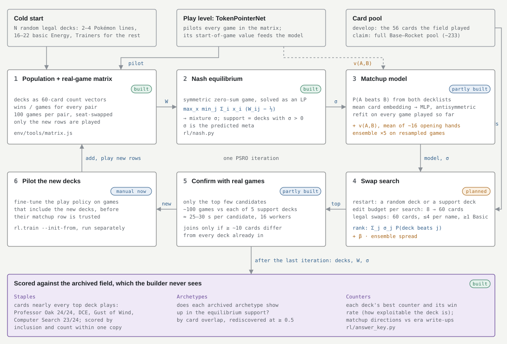

# Metagame RL

A reinforcement-learning project on trading-card-game metagames. The first and main focus is the Pokémon
Trading Card Game (PTCG); other TCGs come later. The roadmap:

1. **July 2000 Super Trainer Showdown** (Pokémon, Base–Rocket): the proving ground (Phase A, now)
2. **Worlds 2005, San Diego** (Pokémon, EX era): a full World Championships metagame (Phase B)
3. **Magic: The Gathering**: a second game, once the approach holds on Pokémon (not started)

The Pokémon environment is
[evcoats/ryuu-play](https://github.com/evcoats/ryuu-play) (branch `sts-2000-pool`), a fork of
[keeshii/ryuu-play](https://github.com/keeshii/ryuu-play), the open-source Pokémon TCG simulator
in TypeScript. The fork is included here as the `ryuu-play/` submodule.

**The goal:** give an agent only a card pool and the rules. It learns to play any deck, learns
to build the decks worth playing, and then is checked against a real historical tournament
metagame that it never saw.

For Pokémon, the end target is a full **World Championships metagame**. The first target is
deliberately much smaller: the **July 2000 Super Trainer Showdown (California)**. It has a 56-card field
that is now fully implemented in the engine and verified. Every part of the system gets built
and proven there first.

## In short

**The approach, in three parts:**

1. **A pilot** (one transformer policy) learns by self-play to play any deck.
2. **A builder** edits decks, judging each one through the pilot's own value and representations.
3. **PSRO** keeps the decks worth playing as an equilibrium mixture, since card metagames are
   rock–paper–scissors rather than one best deck.

The input is only the rules and the card pool: no human decklists, card-specific rules or fitted
priors. The test is whether the result matches a real tournament field it never saw. (Phase A
still has two priors to remove: the builder uses only the 56 cards the field played, and random
starting decks are shaped like human decks, with 16–22 Energy.)

**What is new:**

- **The test is self-discovery.** Does an agent that starts from random decks rediscover what humans
  actually played? Archived lists are used only as the answer key (staples, archetypes, counters),
  never as input.
- **Play and deck building are learned together, by one model.** The builder sees decks the way
  the pilot plays them, so deck quality is defined by play.
- **No prior work combines these for the Pokémon TCG.** We found no published RL work on its deck
  building and play. The closest are surrogate-assisted deck search in Hearthstone and a single
  draft-and-battle policy in Legends of Code and Magic (see the
  [2026-10-06 analysis](notes/analysis-2026-10-06.md)).

**The main lesson so far:** every deck judgment passes through the pilot. A biased or weak pilot
gives a biased or blind builder, so pilot strength is the bottleneck.

## Status

<!-- status:start -->
*Updated 2026-10-20.*

**Where things stand.** A0, A1 and A3 are done; A2 has its ladder and the SimpleBot matchup matrix. Trained pilots
beat SimpleBot (a human-free pilot plateaus near 83%), but every deck search, tournament and learned drafting loop through
log #96 ended in decks unlike the human field, and with the human lists as ground truth (Evan) the cause found was the
pilot: it does not set up before attacking, so every Trainer but Oak and Bill was worth less than an Energy to it, and the
drafting followed it. In the lab (`rl/lab.py`), working the approved three-stage plan (`notes/plan-rediscovery.md`) with
Evan's ideas first, the main line adopted his deck-free board encoder and a larger learning rate (both for strength), but
none of 16 pilot changes has moved the pilot's Trainer competence (0.43–0.48 since 160), so the plan's stall rule has
fired and a larger change waits on Evan. The decks came closest to the human field at 360 (one Trainer-heavy deck type
with five staples, 11.5 cards from the human shape, 67% against the human lists under SimpleBot), after swinging between
Trainer- and Pokémon-heavy shapes, then by 400 traded 7 Trainers for healing special Energy (10.5 Energy above the human
median, 70% against the human lists) in a meta where most training games end by deck-out, and an entropy floor that
steadies the decks costs the pilot 33 Elo. Phase B's engine plays two 2005 lists and passes a fuzz over 340 cards.

**Earlier work:**

- **Log #1–56 (A0–A5, B1–B2; rolled up from eight block summaries).** The engine and environment cover
  the 2000 field and were verified against an oracle (0 mismatches over 1.65M checked decisions), with
  engine faults and free action cycles fixed on the way, and Phase B moved to Worlds 2005, whose engine
  branch plays Birds and ZapTurnDos and passes a 1,500-game fuzz over 340 cards. Trained pilots beat
  SimpleBot (the token model 93% when trained on the archived decks, human-free pilot-v2 near 83%), but
  deck search driven by the pilot's value keeps flooding decks with Energy and no change to the search
  fixed it, neither extra attention nor play-time search transferred to an outside opponent, and the
  first built metagame to beat the archived field (60.7%, [2000s result #1](results/2000s-result-1/)
  and log #40) came from piloting every PSRO iteration. Under the general self-discovery scope set at
  #51, co-evolving the decks and one pilot over the full pool rediscovered Computer Search, Scyther,
  Oak, Energy Removal and Double Colorless Energy but collapsed to one deck type, so the metagame moved
  to a league of deck-owning agents with separate networks and a two-stage real-game adoption check.
- **Log #57–64 (A5).** Tournaments of 3, 6 and 9 agents that each own a network and draft their own deck
  ([2000s result #2](results/2000s-result-2/)) kept every deck type distinct with a 1–2 deck equilibrium,
  after three free action cycles the environment missed were fixed and a per-turn decision cap added, but
  recovered none of the human metagame (0/8 archetypes, 20% against the archived lists): the decks drifted
  into Pokémon piles, partly because the drafting proposed cards by id (225 of 277 are Pokémon) and partly
  because the pilots get little from Trainers. So the meta level is being rewritten as one learned
  procedure (a draft head per agent trained on game results, PPO pilots with a fading prize signal), with
  the old code kept at the `pre-simplify` tag, which now pins the engine the tournaments ran on.
- **Log #65–72 (A5, A4).** The meta level became one loop, `rl/metagame.py` (the old tournament, league,
  PSRO and value-search code kept only at the `pre-simplify` tag): per-agent draft heads froze, so 99 decks
  share one pilot and one draft head that replaces cards in every draw, the worst decks are turned over, and
  the pilot now sees every legal option; from random decks on the full pool it found a Wigglytuff /
  Lickitung core with Double Colorless Energy, Energy Removal and Bill whose best decks broke even with the
  24 archived lists under pilot-v2 (0.52, best 0.64, against result #2's 0.20), a measure that favours them
  because pilot-v2 also leaves draw Trainers unplayed, a habit that forcing draws first shows is largely
  right in the slow meta it built. Pilot work then moved from ablations to architecture changes, each trained
  from scratch on that population's decks against two seeds of the base pilot: board cards tied to their
  Pokémon (fixing attached-Energy counts the model misread), options compared with each other, each
  attack's own rules text, and, at Evan's direction, a board encoder that never sees the deck and then
  cross-attends to a separate deck encoder, so the game state has a deck-free representation. The first
  screen stopped when the PC was shut down overnight, so it was restarted with 40 iterations per arm, scored
  at the same iteration against the base pilot's two seeds; no result yet.
- **Log #73–80 (A4).** About a dozen pilot changes (slot binding, a deck-free board encoder, options attending
to each other, each attack's own text, hidden decklists, three value refits) separated from base by no more than the
evaluation's own noise, and every 40-iteration variant won only 27–38% against SimpleBot on the archived lists
(pilot-v2: 82%). A probe that plays options to the end found that the training signal at lambda 0.95 carries 56–75% of
a move's effect but the value head's one-step change only 14–36%, which more value fitting does not fix (the refits
overfit their 5,200 games), and since pilot-v2 had already shown that longer training plateaus near 83%, the queued
short screens and a proposed long run were dropped. Pointed at Trainer decisions on the 24 human lists
(`notes/scripts/credit_diag.py --focus trainer`), the probe found that the one-step signal carries a Trainer's average
effect (0.41–0.54 of it, twice an average decision's share) but tells the situations that favour it apart poorly, that
under sampled play draw Trainers are worth nothing extra while better timing of Energy Removal, Gust and PlusPower is
worth 0.6–1.3 points a decision, and that with greedy follow-through every Trainer becomes worth timing better, most
for the current recipe (all Trainers +1.3 against +0.35 sampled; Oak +1.4, Bill +0.7), so the pilot's own sampling
after a Trainer erases most of its value, and a lower entropy weight, never tried, is the next arm.
- **Log #81–88 (A4, A5).** Mostly greedy collection lost to plain continued training by 116 Elo while continued
training cut the room for better Trainer timing from 1.3 to 0.4 points a decision, so the short screens had stopped too
early, and the lab (`rl/lab.py`, `notes/plan-lab.md`) replaced them: the metagame loop itself trains as a main line from
meta-99 at a third of the GPU, each change runs as a fork decided against it by a sequential test on drafted decks or by
the answer key, and SimpleBot on both sides joined pilot-v2 as a panel of the drafted decks against the human lists (0.47,
0.62 and 0.58 at meta-99's iterations 49, 99 and 149, 0.53 at the lab's 160). Its A/A cards showed that a fork with no
change can end a segment 13 Elo weaker (a training spread of about 9 Elo), so a pilot change must show 20 Elo and a meta
change 0.03 on the answer key, and a card's reading can swing by 40 Elo between its segments; the first adopted change is
2 PPO epochs instead of 3 (not worse on drafted decks, +40 Elo on the human lists, 19% faster), auxiliary heads with
game-general targets failed (−23 Elo), and value cross-attention, restarted after the adoption, passed its first check.
Each new lab state exposed a bookkeeping bug (a branch never decided after a restart, a card forked before an adoption
losing its control, a retest dropping its test), the first two fixed with a loop test, while the population's median deck kept
swinging between Pokémon-, Trainer- and Energy-heavy shapes over tens of iterations.
- **Log #89–96 (A4, A5, plan).** The lab adopted 6 swaps a draw and passed the result-only draft reward (whose first fork
trained a pilot 30 Elo stronger), value cross-attention failed, and the main line's answer key swung with the pilot doing
the judging (under pilot-v2 0.68 at 200 and 0.48 at 240, under SimpleBot 0.59 and 0.62) as its decks drifted from the
human shape (best decks 20 / 11 / 29 Pokémon / Trainers / Energy against the human lists' 13.5 / 28 / 18). Taking the
human lists as ground truth (Evan), every pilot built so far misplays every Trainer but Oak and Bill (basic Energy beats
search, disruption and tempo Trainers even for pilots trained on the human lists) because it does not set up before
attacking (PlusPower-then-attack lethals at random's 31%), with its inputs and the cards checked, and the drafting
follows it with a collapsed incoming choice; play-time search over the same pilot to the end of the turn lifts
Trainer-first lethals from 60% to 85–88%. Evan's ideas now go first and are tracked in `notes/evan-requests.md`:
practice before a draw counts (seasons), memory and the deck-free encoder as held lab cards, and the approved
`notes/plan-rediscovery.md`, three stages of three steps decided on a competence score (A/A bar 0.06), with expert
iteration toward the turn search, turn-level credit and lasting prize shaping built and queued behind his cards.
- **Log #97–104 (A4, A5).** Evan's ideas ran first in the lab: practice before a draw counts failed in seasons of 5,
and in seasons of 10 it passed its answer-key rule while drafting further from the human shape (10 Trainers / 30 Energy
against the main line's 19 / 25), so it is held for Evan and meta cards are now gated on deck shape. All three memory forms
failed, the result-only draft reward was adopted, and the deck-free board encoder, warm-started with `rl/warmstart.py` after
its deck-blind start was stopped, led by 21–37 Elo over two segments while its population reached the human median of 28
Trainers (a lead over the main line about one A/A shape drift wide). Expert iteration toward the one-turn search at full
weight taught Trainers-first play unconditionally (+10 points on those puzzles) and lost 79 Elo, because a search scored by
the pilot's weak value at the end of the turn favours immediate plays over benching Pokémon, while the main line itself made
its steadiest move toward the human shape (median Trainers 7 → 22 from 240 to 289, competence 0.437 → 0.480, mostly in the 16
PlusPower puzzles); the lab's bookkeeping fragility recurred (it died with the session that started it, and two races
silently dropped hand edits, lowering the competence bar from 0.06 to 0.03 with no decision affected), and all of it is fixed.
- **Log #105–112 (A4, A5).** The lab adopted Evan's deck-free board encoder (warm-started, +37 / +21 / +35 Elo on its
three readings, even on the human lists) and learning rate 2e-4 (+14 Elo), while every Stage 1 change to the training signal
failed on the pilot's competence or strength: expert iteration toward a turn search in all three forms (its targets
disagree with the pilot on 60–70% of probes and make the policy more random, and exact won-the-game targets come up once in
1,194 probes), λ = 1 inside a turn, lasting prize shaping and entropy 0.02, so capacity (6 and 8 encoder layers grown as
the identity, +14 Elo for 6 after one segment) is under test. The drafted population reached the human Trainer count
only in passing: from one state at 300, the main line collapsed to 8 Trainers within 13 iterations (Oak and Bill out,
Colorless Pokémon in; the 320 milestone measured it: answer key 0.34, best decks 38 cards from the human shape) while the
learning-rate fork kept 23–29 and, adopted, went on at 8 / 32 / 19, which traces to a draft head whose incoming choice is
collapsed (0.1–0.3 nats), so a floor on that choice's entropy, held by a sampling temperature after an entropy weight failed
its test, is under test on a 40-iteration stability rule. Three more bookkeeping faults surfaced and were fixed (the lab
died with its session, two races dropped hand edits, a rebase dropped a card's decision rule), each of which had silently
changed or risked changing a decision rather than failing loudly.

**Recent (log #113–119):** The two milestones on the line adopted at 320 drafted one deck type, two Colorless walls (4
Chansey / 4 Snorlax with Oak, Bill, Computer Search, Energy Removal and Double Colorless), which beats the human lists 67%
at 360 and 70% at 400 under SimpleBot on both sides, the panel's best, but 28–29% under pilot-v2, which misplays its
Trainers; by 400 it had swapped 7 search Trainers for healing special Energy (Potion and Full Heal Energy, played by 0 and 3
of the 24 human lists), 10.5 Energy above the human median, a ground-truth warning that fits a meta where most training
games end by deck-out because the pilots rarely take six prizes. A 3-nat floor on the draft head's incoming entropy held the
decks' median Trainers within 3 over 40 iterations (main line 8) but cost the pilot 33 Elo, the 2-nat floor steadied
nothing, and the deeper pilots and a warm-started slot binding failed, so none of the 16 pilot cards since the plan began
has moved Trainer competence (0.43–0.48 since 160, 0.460 at 400), and the plan's stall rule has fired: small cards stop, and
the choice of a larger change goes to Evan. A slower draft head (learning rate 3e-4), queued before the stall, was adopted at
380 on weak evidence (the main line was itself calm in that window, the first ever within 5 Trainers, then moved 8 over
360–399), and the plan's from-scratch check
of the adopted recipe, restarted at a smaller micro-batch after running out of memory on random decks, runs as a lab slot.

The full record is in [`notes/progress-log.md`](notes/progress-log.md).

**Next:**

1. Evan's choice of the larger change the stall rule calls for (log #116): a bigger pilot through distillation, a league,
   or a different draft procedure; my recommendation is in the session report.
2. The from-scratch check (`016-scratch-recipe-m`, from 380): measured every 40 of its iterations, done in about a day
   (at its iteration 9, still in the random start where almost every game ends by deck-out).
3. The 440 milestone: whether the healing special Energy stays, and the Energy count against the human median of 18.
4. Evan's call on `008b-meta-practice10`; Phase B in parallel (verification, 2005 rules, card-text fixes).
<!-- status:end -->

---

## The problem: three decisions stacked

| Level | Decision | Horizon | Learned by | Signal |
|---|---|---|---|---|
| **Move** | Which card, which target, which search pick | One prompt | Policy network over the legal candidates | Policy gradient and value from the game level |
| **Game** | How to pilot a fixed 60-card deck under hidden information | ~135 actions per game in this format | Self-play against a population of opponents | Win or loss |
| **Metagame** | Which deck to bring, given what everyone else brings | One tournament field | A deck-edit policy inside a PSRO loop | The matchup table produced by the game level |

Card metagames are non-transitive (rock–paper–scissors on top of raw power), so the target at
the top level is an **equilibrium mixture of decks, not one best deck**. The three levels are
coupled: play skill decides which decks look good, and the decks in the field decide which
play skills matter.

**Ground truth.** Archived tournament results are the answer key. The agent drafts its own meta
from random decks on the full card pool and never sees the archived lists; its meta is what it
knows about decks. An agent that lands on what humans actually played has shown something that
win rates against its own checkpoints cannot. Human metagames are not equilibria, so matching
meta *shares* is not the goal. The comparison has three tiers (`rl/answer_key.py`):

1. **Staples:** cards nearly every top deck plays, at near-fixed counts. In the 2000 field,
   Professor Oak is in 24 of 24 lists, and Double Colorless Energy, Gust of Wind and Computer
   Search in 23. These hardly depend on the opponent, so the agent's decks should agree even
   where the archetype mix differs. Scored by inclusion, and by count within one copy. Staples
   such as Gust of Wind and Energy Removal only earn their slot under a pilot that uses them
   well, so this tier also tests play.
2. **Archetypes:** does each archived archetype appear in the agent's equilibrium support, by
   card overlap with the archived lists?
3. **The meta:** the counter table (each deck's best counter, with its win rate and how
   exploitable the deck is) and matchup directions, checked against era write-ups.

---

## Why start in 2000

| | July 2000 STS (Base–Rocket) | Worlds 2005, San Diego (EX Ruby & Sapphire–EX Emerald) |
|---|---|---|
| Card pool in ryuu-play | **Complete**: every card in the field is implemented and verified | Partial: 3 of the 9 EX sets are in the engine (not yet verified); about 100 of the 139 card names in the season's archetype lists still need an implementation (see B1) |
| Distinct cards in the field | **56** (21 Pokémon, 26 Trainer, 9 Energy) | 139 card names across 19 archetype lists; nine EX sets plus POP Series 1 and promos in the format |
| Evolution | Three stacks in the whole field, max depth 2 | Deep lines, Rare Candy, many evolution engines |
| One player's full observation | **482 bits ≈ 60 bytes**; ~760–870 floats one-hot | Needs the scalable token representation |
| Recorded field | 24 top-8 lists across three age divisions | One archived list per archetype so far (ptcgarchive) and the four official 2005 World Championship decks; full top-cut lists not yet sourced |
| Mechanics | No abilities-era complexity, no EX/GX prize rules, no ACE SPEC | Poké-Powers and Poké-Bodies, Pokémon-ex (two Prizes), Dark Pokémon; all already in the engine. No ACE SPEC, no Lost Zone, no LEGENDs |

The 2000 format is small enough to iterate on in hours on one machine and real enough to have
an answer key. Its weakness is also clear: there is **one** recorded field, and it is
concentrated (Wigglytuff 10/24, Haymaker 7/24, 8 archetypes). It can answer "does the agent find
Wigglytuff and Haymaker?" well. It cannot validate a predicted distribution. That is why it is
the proving ground and not the end result.

**The rule for Phase A:** anything that must scale to Worlds (the token representation, the
deck-general policy, the PSRO loop, the evaluation protocol) gets proven on 2000 first, against
a simpler baseline it must match or beat.

---

## Plan

### Phase A — Proving ground: July 2000 STS California

#### A0. Engine covers the field — ✅ done

On the engine fork, branch `sts-2000-pool`:

- Fossil Ditto re-enabled, and its two open TODOs closed (copying passive Pokémon Powers, and
  offering copied in-play Powers). Mr. Mime's Invisible Wall and Muk's Toxic Gas now work
  through Ditto.
- A new Wizards Black Star Promos set with the two promos the field played: Mewtwo #3 and Mew #8.
- **Verification:**
  - All 24 archived decklists build and start a game.
  - 541 engine specs pass (25 new).
  - 68/68 targeted card-interaction tests pass.
  - 1,926 card-data field checks against pokemon-tcg-data, with 1 cosmetic mismatch.
  - 22/23 dated 2000-era rulings pass. The failure (T18, Mysterious Fossil as a starting Basic)
    doesn't affect this field.
- **Measured:**
  - The engine runs ~9 real games/s per core and scales near-linearly to 8 workers.
  - No first-player bias is detectable (seat A won 54.5% ± 5.8 over 288 mirror games).
  - SimpleBot, the bundled bot, costs ~30× the engine per move (0.6 games/s/core), so it is an
    evaluation floor, not a self-play opponent.

#### A1. Make the engine an RL environment — ✅ done

The engine was built for a websocket server, not for millions of headless games. It has no
legal-move enumerator: an illegal action throws, and the store restores a deep-cloned backup.

1. **Throughput fixes — ✅ done** (fork `888b385`).
   - Stop deep-cloning `state.logs` on every dispatch. It grew all game long, which made a game
     O(n²) in its length.
   - Cache the card order in `propagateEffect`, rebuilding it when a new card appears.
   - Measured **554 → 160 µs/action (3.5×), 18.7 → 64.6 engine-only games/s/core**, with the
     state identical to the old engine after every action over 300 seeded games
     (`notes/scripts/ryuu_engine_equivalence.js`).
2. **Legal-action enumerator — ✅ done** (`env/legal.js`). At every decision, list the candidate
   actions: play card, attach, evolve, retreat, use Power, attack, pass, and the options of
   every open prompt. Verify it against the engine: every enumerated action must be accepted,
   and a sampled non-enumerated action must be rejected. Verified against an exhaustive oracle
   (`env/oracle.js`) on every decision of 10,000 games: 0 mismatches.
3. **Observation encoder — ✅ done** (`env/encode.js`): 1,110 byte-exact features (12 slots ×
   54 plus hand, discards, unseen cards, counts) and 1,915 action ids. Hidden information stays
   hidden: the opponent's hand shows as a size, and prizes are unknown to both players.
4. **Environment API — ✅ done** (`env/env.js`): `reset(deckA, deckB, seed) → obs, legal` and
   `step(action)`. Seeded, so games replay exactly. Each worker process runs many games
   (`env/runner.js`).
5. **Training bridge — ✅ done.** *Decision:* rollouts in Node with ONNX inference
   (`env/rollout_worker.js`), training in PyTorch (`rl/train.py`), syncing weights each
   iteration.
6. **Housekeeping — ✅ done.**
   - Fix T18 (fork `fc4c8ec`, `Rules.fossilsAsStarters`).
   - Run the spec, interaction, rulings and decklist checks as CI (`.github/workflows/ci.yml`),
     plus the engine equivalence, env and enumerator checks.

**Exit:** a seeded, enumerated, encoded environment at ≥ 50 random-policy games/s/core, with
the enumerator verified on every action across ≥ 10k games. *Met: 0 mismatches over 10,000
games; 53.9 random-policy games/s/core (`env/tools/bench_env.js`).*

#### A2. Baselines and the evaluation ladder

- **Opponents:** random, a cheap heuristic bot, SimpleBot (floor), and a fixed-budget search
  bot as a relative scale.
- **Protocol:** every comparison is seat-swapped, with fixed decklists and confidence intervals.
  At 200 games the standard error is ~3.5 points.
- **Puzzles:** positions in this format with provable answers, such as lethal this turn,
  avoiding deck-out, and the right Energy Removal target.
- **Skill-ceiling baseline:** the full 24 × 24 matchup matrix and its Nash equilibrium **under
  SimpleBot**. This is the reference for how the discovered meta shifts as play improves.

#### A3. Game level, one matchup — ✅ done

PPO with a small self-play league, on the field's top two archetypes (Wigglytuff vs Haymaker),
using the identity-indexed encoding from A1.

**Exit:** beats SimpleBot by a clear, seat-swapped margin in both directions of the matchup, and
the result holds against held-out league checkpoints, not only its training opponents.

#### A4. Game level, every deck

1. **One deck-general policy**, conditioned on its own decklist and the opponent's, trained
   across all 24 archived lists.
2. **The scalable representation**, built here and required to match A4.1 before Phase B: card
   tokens, a verb head plus a pointer head over the legal candidates, and card embeddings built
   from card features and rules text.

**Exit:** beats SimpleBot with every deck; the trained-policy matchup matrix is stable across
reruns; and its matchup directions agree with era write-ups wherever those exist.

#### A5. Metagame level



*The loop as of log #28 ([full page](notes/schematics/metagame-builder.html)). Since log #34, step 4 in the code is the restart search of `rl/search.py` (`rl/psro.py --builder games|model|value`); the PPO edit policy remains as `--builder edit`. Since log #65 the code is one loop instead (`rl/metagame.py`: per-agent draft heads trained on game results, `rl/draft.py`); the PSRO builder is at the `pre-simplify` tag.*

1. **Fixed population.** Nash over the trained-policy matrix of the 24 archived lists. Do
   Wigglytuff and Haymaker sit in the support? Compare against the SimpleBot equilibrium from A2.
2. **Deck builder: PSRO with a matchup model.** A deck population, its real-game matchup
   matrix and its Nash mixture. Each iteration:
   1. Solve Nash over the population's real-game matrix.
   2. Search card swaps (under the construction rules), ranked by the matchup model's predicted
      win rate against the Nash mixture, from several starting decks.
   3. Play real games for the top few candidates, add them to the population, refit the model.

   - **The matchup model** predicts P(A beats B) from both decks (mean of the token model's card
     embeddings, so unseen cards are covered) plus the pilot's value at the start of the game,
     v(A, B), averaged over ~16 opening hands (forward passes, no games). The value feature
     starts the model at the pilot's own judgment; it learns where the pilot is wrong, mostly on
     decks the pilot has not trained on. It is fitted on every real game played so far, and only
     ranks: every number that enters the matrix is from real games.
   - **Exploration**, by two mechanisms:
     - **Random restarts with varied edit budgets.** Each search starts from a fresh random
       legal deck or from a support deck, with a budget, drawn per search, on how many cards it
       may change: from 8 (refining a support deck) to 60 (a full rewrite). This decides where
       the search looks: many separate basins rather than one deck refined forever.
     - **Optimism under uncertainty.** The matchup model is a small ensemble (about 5, trained
       on resampled games), and candidates are ranked by mean + β × spread. Where the copies
       disagree is where the model has seen few games, so unusual decks get tried, and the bonus
       shrinks once their games are in. This decides which candidates get real games.
     - A new deck joins the population only if it differs from every existing deck by at least
       ~10 cards, so the population does not fill with near-copies.
   - **Is exploration working?** Cold starts from different seeds reach overlapping supports (by
     card overlap); new decks keep entering the support, and the share of the pool tried keeps
     growing; and the model's error on newly tested decks stays small. Disagreeing seeds with a
     stalled support mean explore more.
   - New decks get piloting time before their matchup row is trusted.
   - Left out unless plain search stops finding new support decks: an RL-trained edit policy,
     MAP-Elites, a rectified-Nash solver, exploiter episodes.
3. **Two pool sizes.** Develop on the 56 cards the field played, which leaks human card choice
   but is cheap. Make the actual claim on the **full legal Base–Rocket pool** (all legal promos
   are now in: Wizards Black Star Promos #1–#16, fork `64330a4`). Most of those ~233 cards are
   unexercised by tests, so a cold-start builder will find engine bugs and treat them as
   strategies; expand verification first.
4. **Counters.** For every deck in the agent's population, its best counter and that counter's
   win rate (the deck's exploitability), from the matchup matrix. Then a counter-deck search:
   the builder aimed at one opponent deck instead of the meta mixture, over the whole pool, with
   the matchup model proposing and real games confirming. It answers "what beats X best?",
   possibly with a deck no one played. The archived decks are also scored as held-out entries
   against the agent's equilibrium: how would each human list have fared in the agent's meta?

**Exit:** from a cold start on the full pool, scored with the three-tier answer key: the agent's
mixture plays the field's staples at near-field counts, archived archetypes appear in the
equilibrium support (by card overlap), and the counters and matchup directions agree with era
write-ups where those exist. The result replicates across seeds. The three age divisions serve as
rough replicates of the human field.

#### A6. Play knowledge feeds deck building

- Measure what the play network's start-of-game value adds to the matchup model (A5.2): the
  model with and without it, scored by prediction error on newly tested decks, and the value
  alone as the ranking.
- Reuse the play encoder's card-interaction weights to score candidate cards.

**Phase A exit gate**, all required before starting Worlds work in earnest:

- The token-pointer policy matches the identity-indexed one.
- Cold-start rediscovery succeeds on the full pool.
- The evaluation protocol and environment run unattended.

---

### Phase B — Full Worlds metagame

Phase B reuses everything from Phase A. What is new is the card pool, the scale, and the data.

#### B1. Target: Worlds 2005, San Diego

The 2005 World Championships (San Diego, August 19–21, 2005) were played in the Modified format:
EX Ruby & Sapphire, Sandstorm, Dragon, Team Magma vs Team Aqua, Hidden Legends, FireRed &
LeafGreen, Team Rocket Returns, Deoxys and Emerald, plus POP Series 1, the EX Trainer Kits and
Nintendo Black Star Promos 1–27. Wizards' four 2005 World Championship decks reproduce top
players' lists: Queendom (Jeremy Maron), Dark Tyranitar (Takashi Yoneda, a finalist), King of the
West (Michael Gonzalez) and Bright Aura (Curran Hill).

Chosen by measurement over Worlds 2011 (San Diego) and 2013–14. The card gap is about the same as
2011's, and 2005 needs no new engine mechanics.

- **Coverage, measured** (`notes/scripts/ryuu_coverage_season.py`, results in
  `notes/data/eval/coverage_2005.json` and `coverage_2011.json`; every card resolved to its
  printing through pokemon-tcg-data):

  | | 2005 | 2011 |
  |---|---|---|
  | Archetype lists (ptcgarchive) | 19 lists, 139 names | 13 lists, 111 names |
  | Names still to implement | ~100 (72%) | ~79 (71%) |
  | Copies buildable today | 362 of 1,140, +65 near-reprints to check | 334 of 780 |
  | Closest list | Zapdos/Moltres "Birds" 40/60 | Reshiram/Typhlosion 42/60 |
  | Full legal pool | 3 of 9 EX sets present, ~600 cards to go | ~35 cards of 6 sets present, ~600 to go |
  | New engine mechanics | none | Lost Zone, LEGEND cards |

  No list in either season is fully buildable yet. The most-played missing 2005 cards are
  Supporters and Trainers from the missing sets (TV Reporter, Steven's Advice, Rocket's Admin.,
  Swoop! Teleporter), Jirachi (Deoxys) and the Team Rocket Returns Dark Pokémon. "Different"
  (same name, different card) slightly over-counts, since a few are wording-only changes.
- **The engine's EX sets:** Ruby & Sapphire, Sandstorm and FireRed & LeafGreen are
  near-complete (about 109, 98 and 112 cards) but not yet checked against card data and
  rulings as the 2000 pool was.
- **2013–14, for comparison:** two archived Worlds Blastoise/Keldeo lists build 57 of 60 cards,
  but all of Team Plasma and Black Kyurem-EX are missing (`notes/tcg-rl-research-notes.md`).
- **Data:** the season's archetype lists (ptcgarchive, saved in
  `notes/data/2005-season-ptcgarchive/`) and the World Championship decks. Full Worlds 2005
  top-cut lists and placements are still to be sourced.
- **Legality:** build the 2005 legal pool from set codes. The current pool mixes sets that never
  coexisted, and an agent would invent decks no one could have played.

#### B2. Close the card gap with the Phase A verification pipeline

For every new card: card-data checks against pokemon-tcg-data, dated rulings tests, targeted
interaction tests, and every archived Worlds list as a regression deck.

#### B3. Scale

- The token representation carries over unchanged.
- Re-profile the engine on the larger pool and rerun the throughput budget before sizing PSRO.
  At 200 games per pair, one new row in a 40-deck population costs ~8,000 games.

#### B4. Game level, then metagame level on the Worlds pool

Same exit criteria as A4 and A5, measured against the archived Worlds top cut.

#### B5. Human evaluation

- Run the agent on a ryuu-play server against players who know the era (TCG ONE's Legacy format
  covers this pool).
- Use fixed archived lists, seat-swapped, ~200 games per opponent pool.
- The defensible claim is "beats experienced players on fixed lists within this pool."

---

## Risks

- **Play skill and the meta are coupled.** A weak pilot undervalues setup decks. Which
  archetypes appear as play improves is tracked as a result in its own right.
- **Engine bugs become meta bugs.** Archived lists double as regression decks, and the builder
  is only let loose on cards with test coverage.
- **One field in 2000.** The STS gives a single 24-deck field (STS New Jersey is a Gym-era format
  needing two unimplemented sets, 0/24 buildable). Phase A success means yes/no rediscovery,
  not distribution matching.
- **Human metas are not equilibria.** Rediscovery is the comparison; share percentages are not.
- **Worlds coverage.** "From scratch" claims in Phase B hold only for the buildable pool until
  B2 closes the gaps.

---

## Repository

| Path | Contents |
|---|---|
| `ryuu-play/` | Submodule: the engine fork, pinned to a commit on `sts-2000-pool`. Engine changes are committed there and the pin is bumped here. |
| `notes/progress-log.md` | Append-only log of finished todos, from which the Status section is summarized |
| `notes/analysis-2026-10-06.md` | Analysis of logs #30-42 with a literature survey and the ranked next steps |
| `results/` | Headline results, one folder each with a README, data and the scripts to reproduce them ([index](results/README.md)); [2000s result #1](results/2000s-result-1/) is the A5.2 builder comparison |
| `notes/schematics/` | Diagrams of the system, as standalone HTML pages: `metagame-builder.html` (and the `.svg` shown under A5) is the A5 PSRO loop, marked built vs planned |
| `env/` | The RL environment: seeded game loop, legal-action enumerator and its oracle, encoder, env API, rollout runner and workers; `env/tools/` has the verification, test, benchmark and evaluation scripts |
| `rl/` | The learner: PyTorch models, ONNX export, rollout reader, PPO training (`python -m rl.train`) |
| `notes/tcg-rl-research-notes.md` | The research log and RL design, including the comparison with [Pokemon_TCG_RL](https://github.com/SuryaSGit/Pokemon_TCG_RL) (v4) |
| `notes/three-level-rl-pitch.md` | The three-level (move / game / metagame) pitch |
| `notes/sts-2000-engine-check.md` | The 2000 verification report: coverage, throughput, profiling, state vector |
| `notes/data/` | The archived STS decklists (scraped from ptcgarchive.com), aggregated to CSV and JSON |
| `notes/scripts/` | Harness, verification and measurement scripts (Node for the engine, Python for scraping and card-data checks) |

`notes/data/cache/` (raw scraped pages and the pokemon-tcg-data download) is not committed;
`meta_aggregate.py` and `ryuu_card_data_check.py` rebuild it on first run. The three
`*_v4.py` / `dims_v5.py` probes expect a local Pokemon_TCG_RL checkout at a hard-coded path.

### Setup

Requires Node.js 18.19+ (developed on Node 24).

```
git clone --recurse-submodules https://github.com/AI-Alignment-UIUC/metagame-rl
cd metagame-rl/ryuu-play
npm install --workspace=packages/common --workspace=packages/sets --workspace=packages/simple-bot
npm run compile -w packages/common && npm run compile -w packages/sets
(cd packages/sets && npx jasmine-ts "tests/**/*.spec.ts")      # 541 engine specs
cd ..
node notes/scripts/ryuu_sts_decks_check.js        # 24/24 archived decks build and start
node notes/scripts/ryuu_rulings_tests.js          # 22/23 (T18 open)
```

The scripts find the engine at `ryuu-play/` by default; pass a path or set `RYUU_PLAY` to
point them elsewhere.

The environment and training (from the repository root):

```
npm install                                        # onnxruntime-node for the rollout workers
node env/tools/test_env.js                         # env API and encoder
node env/tools/verify_enumerator.js --games 200    # enumerator vs. the oracle
node env/tools/bench_env.js                        # random-policy games/s on one core
node env/tools/evaluate.js --x simplebot --y random --games 200
py -3 -m venv .venv && .venv/Scripts/pip install torch numpy onnx   # (CUDA build of torch from download.pytorch.org)
.venv/Scripts/python -m rl.train --run runs/try --matchup "Wigglytuff|Haymaker" --both-directions
```

## Credits

The engine and the ~900 card implementations are by keeshii and the ryuu-play contributors
(MIT). Card data was checked against
[PokemonTCG/pokemon-tcg-data](https://github.com/PokemonTCG/pokemon-tcg-data). Tournament data
is from [ptcgarchive.com](https://ptcgarchive.com/).
